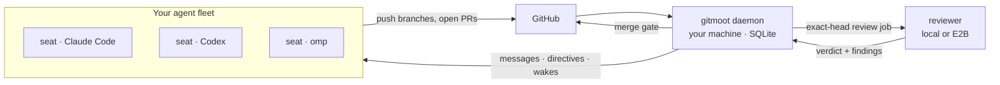

<p align="center">
  
</p>

<div align="center">

[](./LICENSE)
[](https://github.com/gitmoot/gitmoot/releases)
[](https://github.com/gitmoot/gitmoot/actions/workflows/ci.yml)
[](https://gitmoot.io/docs/intro)
[](https://gitmoot.io/llms.txt)
[](./go.mod)

# Run a fleet of coding agents like a team.

**Gitmoot organises your AI coding agents into roles, keeps them talking,
and gates what they merge behind an independent review at the exact commit.**

[Install](#quick-start) · [How it works](#how-it-works) · [Docs](https://gitmoot.io/docs/intro) · [llms.txt](https://gitmoot.io/llms.txt)

</div>

One agent in one terminal is easy. Ten agents across twenty repos, running
overnight, is a team, and teams need structure: who owns what, who reviews
whom, who may merge, and who gets woken up when something lands.

Gitmoot is that structure. Your agents (Claude Code, Codex, omp, Kimi) do the
work in their own sessions. Gitmoot gives each one a **seat** with a role and a
scope, carries **messages and directives** between them, and sends their pull
requests to a **different agent** for an exact-commit review, as deep as the
risk calls for. Where review comes first, the merge waits until it is earned.
It all runs on your machine: one
static binary, one SQLite file, no hosted control plane.

<table>
  <tr>
    <td align="center"><b>3,105</b><br><sub>independent reviews</sub></td>
    <td align="center"><b>61</b><br><sub>repositories</sub></td>
    <td align="center"><b>51</b><br><sub>agent seats</sub></td>
    <td align="center"><b>~1 min</b><br><sub>from request to reviewer</sub></td>
  </tr>
</table>
<p align="center"><sub>The maintainers' own fleet, 30 days to November 2026. Gitmoot reviews and coordinates its own development.</sub></p>

## What it does

### 🪑 Organise the fleet

Every agent session gets a seat: a role, a parent, a repository scope and an
explicit merge authority. Seats are agent sessions running in
[Herdr](https://github.com/jerryfane/herdr) panes, so Gitmoot knows which
session is which seat and can reach it. The org chart is the source of truth
for who does what, so agents stop guessing and stop colliding.

```sh
gitmoot org seat add frontend-dev --pane <herdr-pane> --parent lead --scope acme/web --merge-rule none
gitmoot org chart                     # who reports to whom, and what each seat owns
gitmoot org status                    # who is working, waiting or idle right now
```

### 💬 Keep them talking

Seats send each other durable messages, assign directives, and escalate to
a human when they are stuck. A seat that requests a review is woken when the
verdict lands, so nobody sits polling.

```sh
# run from a seat's pane: the sender is the seat
gitmoot message send reviewer-lead "PR 412 is ready, migration included"
gitmoot message escalate --to owner "Ship the schema change tonight or wait for Monday?"
gitmoot org await review --role frontend-dev --repo acme/web --pr 412 --head <sha> --ttl 2h
```

### 🔍 Review the work, at the exact commit

A review is a separate job on a separate agent, bound to the 40-character head
it was asked about. If the branch moves, the old verdict stops counting.

```sh
# from a seat: the verdict comes back to it
gitmoot review request --repo acme/web --pr 412          # the router picks reviewer and model
gitmoot review status  --repo acme/web --pr 412
gitmoot findings --repo acme/web --pr 412 --at-head <sha>  # what still blocks this merge
```

- **The right depth for the change.** An optional risk classifier sorts PRs
  into three levels: merge on green CI, review after merge, or review before
  merge.
- **Delta reviews** read only what changed since the last verdict. `--full`
  asks for a whole fresh look at the diff.
- **A findings ledger** tracks every finding per head until it is answered, and
  the merge gate blocks on whatever severity you configure.
- **Reviews that can't run code** (`--no-execution`, or checks like Xcode that
  the sandbox can't run) accept exact-head CI evidence the reviewer verifies
  itself.
- **Off-box reviews** run in E2B sandboxes (`--exec-backend remote`) with a hard
  dollar cap, read-only private evidence and sibling PRs (`--related-pr`), and no
  credentials inside.

### 🌙 Run unattended

The daemon watches your repositories, dispatches reviews, and wakes seats.
Branch and checkout locks, crash recovery after reboots, per-job budgets,
throwaway review worktrees that are reclaimed in the background, and a
`daemon drain` for restarts without losing work. Overnight is the normal case.

## How it works



Local SQLite is the source of truth; GitHub is where the work is visible. Agent
runtimes sit behind one adapter contract, so a Claude seat can be reviewed by
an omp reviewer on another model.

## Quick start

```sh
# 1. Install the single static binary
curl -fsSL https://gitmoot.io/install.sh | sh

# 2. Register a repository and an agent, and start the daemon
gitmoot setup --repo owner/repo --path . --agent reviewer --runtime claude --session last --start-daemon

# 3. Ask for an independent review of a pull request
gitmoot agent review reviewer "Review this PR." --repo owner/repo --pr 123 --no-fix-target
```

Or let your coding agent do it. Paste this into it:

```text
Install gitmoot (curl -fsSL https://gitmoot.io/install.sh | sh), set it up for this
repo with `gitmoot setup`, and verify with `gitmoot doctor`.
The docs index for agents is https://gitmoot.io/llms.txt
```

| Runtime | Flag | Notes |
|---|---|---|
| Claude Code | `--runtime claude` | `--session last` reuses your login |
| Codex | `--runtime codex` | `--effort` sets reasoning effort |
| omp | `--runtime omp` | multi-provider model pools; runs local or in E2B |
| Kimi Code | `--runtime kimi` | `kimi login` first, then restart the daemon |
| Shell | `--runtime shell` | deterministic checks, no model |

More: **[Install](https://gitmoot.io/docs/getting-started/install)** ·
**[Quick start](https://gitmoot.io/docs/getting-started/quick-start)** ·
**[Reviews](https://gitmoot.io/docs/workflows/review-agent-workflow)** ·
**[CLI reference](https://gitmoot.io/docs/reference/cli)**

## Also in the box

- **Orchestration.** A coordinator fans work out to several agents and merges
  the answers: `gitmoot orchestrate lead "Review PR #123 from three angles." --recipe review-panel`.
- **Pipelines.** Agent graphs saved as YAML that you can rerun, schedule and
  inspect ([docs](https://gitmoot.io/docs/workflows/pipelines-workflow)).
- **PR comments.** `/gitmoot <agent> ask …` on a PR or issue routes to a named agent.
- **Proof.** `gitmoot proof` builds an evidence-graded manifest of what a job
  tree actually did.
- **Dashboard.** `gitmoot dashboard` in the terminal, or a read-only web view.

## Documentation

- **[Hosted docs](https://gitmoot.io/docs/intro)**: guides, concepts and reference
- **[llms.txt](https://gitmoot.io/llms.txt)**: the docs index for agents ([full text](https://gitmoot.io/llms-full.txt))
- **[Agent skill](skills/gitmoot/SKILL.md)** and **[CLI reference](skills/gitmoot/references/CLI.md)**, versioned with the code
- [Release notes](https://gitmoot.io/docs/release-notes/v0.9.7) · [Troubleshooting](https://gitmoot.io/docs/operations/troubleshooting)

## Design limits

- **Local-first.** State lives in SQLite on your machine. Only reviews you send
  to E2B run elsewhere.
- **Polling, not webhooks.** The daemon polls GitHub; there is no GitHub App.
  Comments are posted as your authenticated `gh` user, with the agent named in
  the body.
- **Seats implement; Gitmoot reviews.** Gitmoot no longer dispatches
  implementation work itself. Your agents write the code in their own sessions;
  Gitmoot coordinates them and reviews what they ship.

## Contributing

Gitmoot is moving fast. Keep changes scoped, keep it local-first, add focused
tests, and ship docs with code. [AGENTS.md](AGENTS.md) has the full engineering
contract. Every change to this repository gets an independent Gitmoot review
before it merges.

```sh
go build ./... && go vet ./... && go test ./...
```

<a href="https://github.com/gitmoot/gitmoot/graphs/contributors">
  
</a>

## Acknowledgements

Gitmoot stands on the runtimes it coordinates ([Claude Code](https://claude.com/claude-code),
[Codex](https://github.com/openai/codex), [Kimi Code](https://github.com/MoonshotAI) and omp) and on
[modernc.org/sqlite](https://pkg.go.dev/modernc.org/sqlite), which keeps the
single-binary, no-cgo promise honest. Thanks to the builders stress-testing it
in the wild, including the [council](https://github.com/plotarmordev/council)
multi-model quorum system.

Gitmoot Pipelines started at OpenAI Build Week 2026; the submitted tree is
kept at the [`buildweek-2026-submission`](https://github.com/gitmoot/gitmoot/tree/buildweek-2026-submission) tag.

## License

Apache License 2.0. See [LICENSE](./LICENSE) and [NOTICE](./NOTICE).
